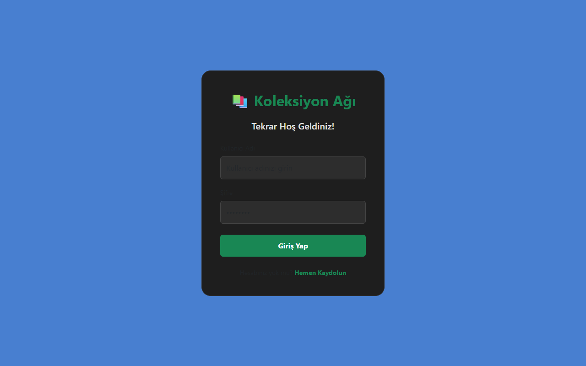
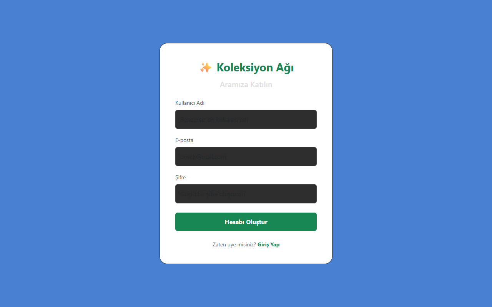
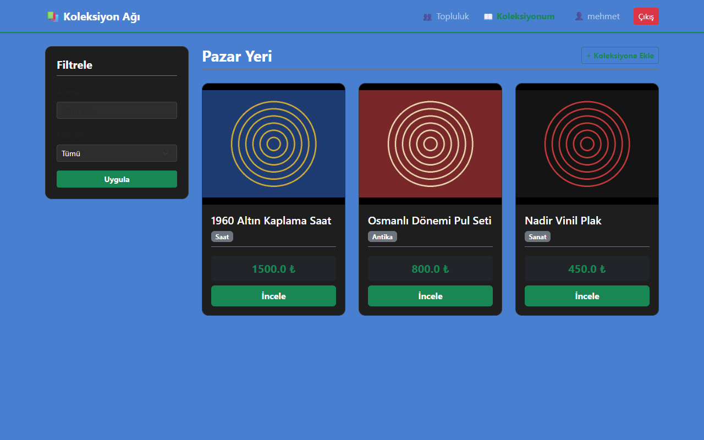
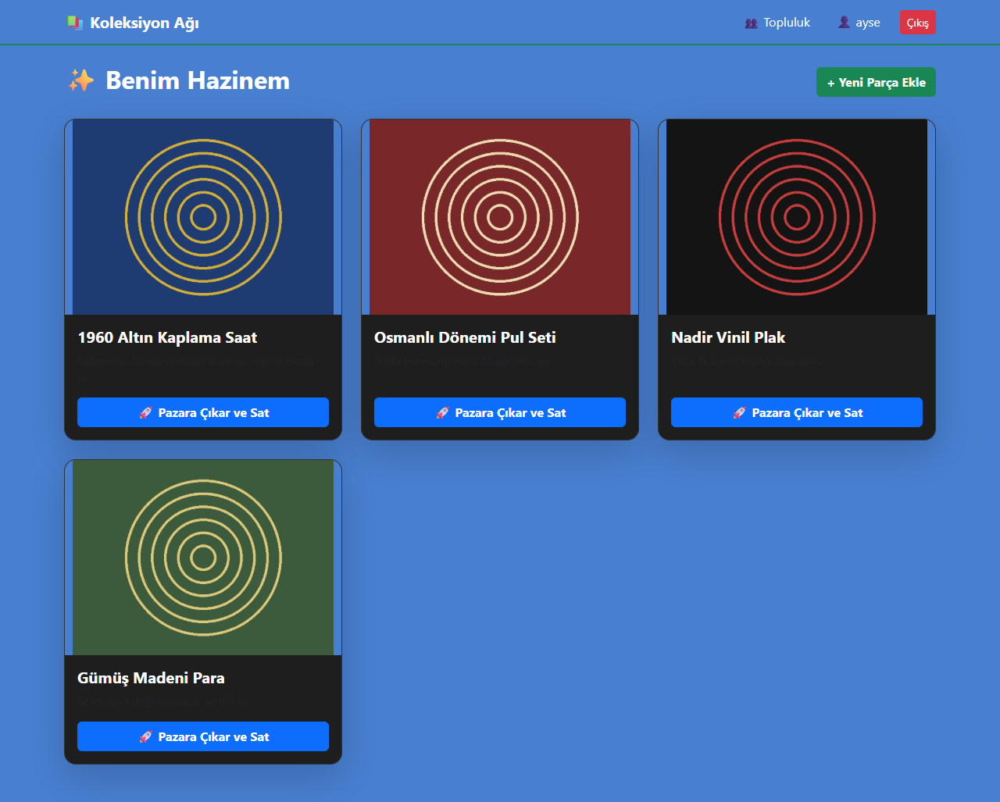
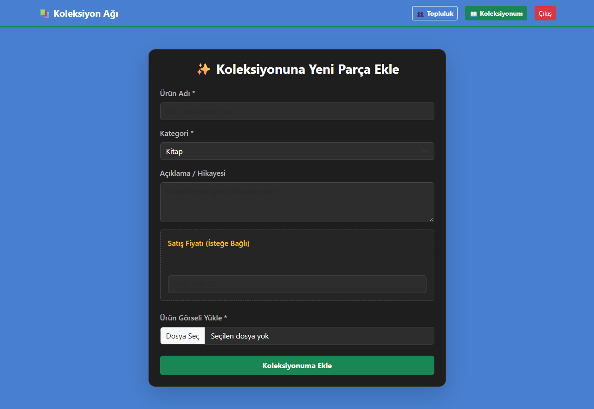
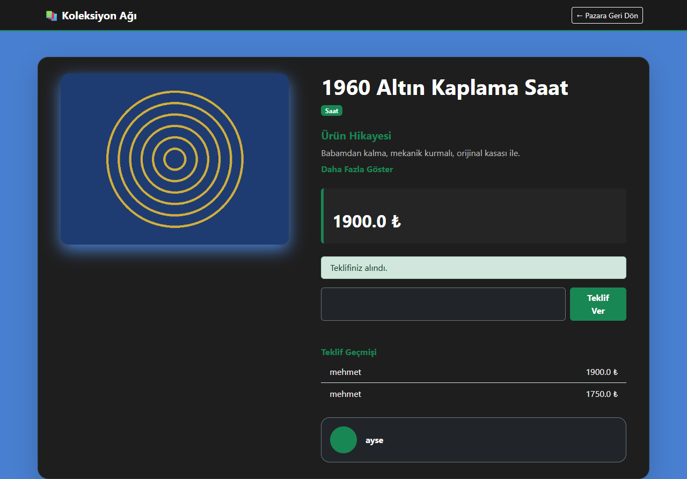
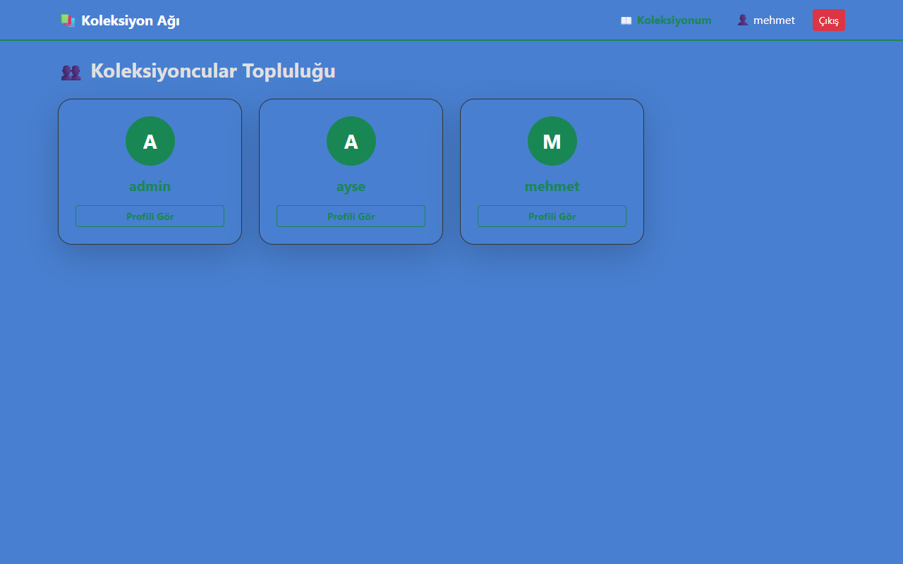
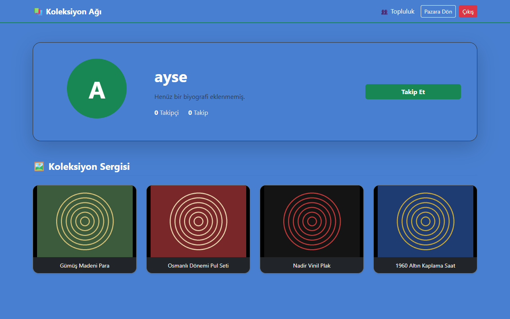
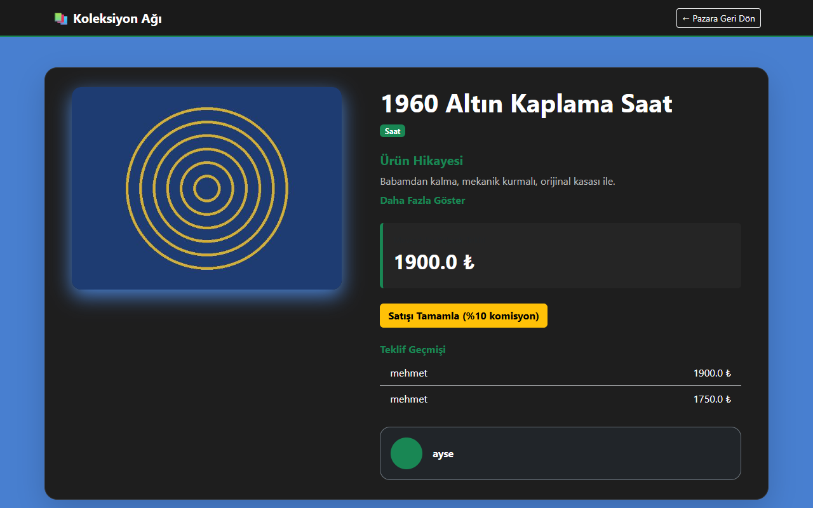
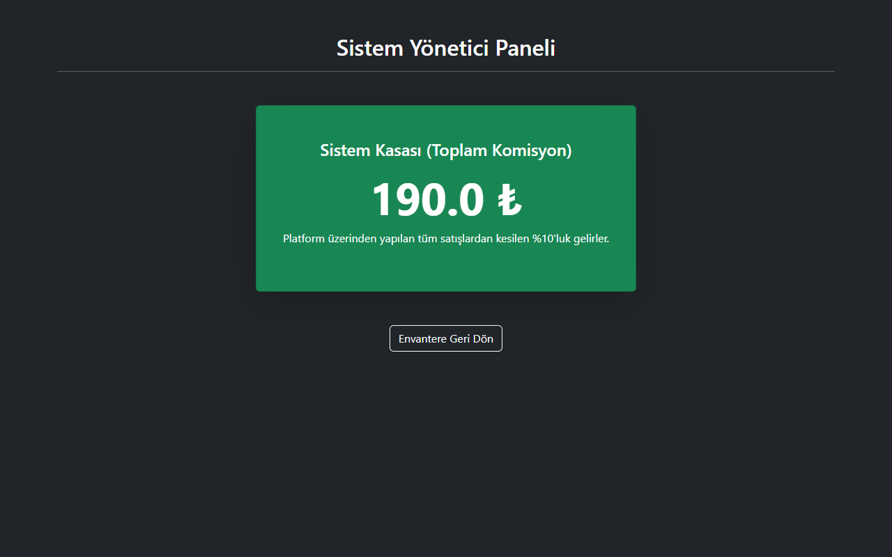

# 📚 Koleksiyon Ağı

Koleksiyonerler için geliştirilmiş **sosyal ağ ve açık artırma pazarı**. Kullanıcılar kendi koleksiyonlarını oluşturur, parçalarını satışa çıkarır, diğer koleksiyonerleri takip eder ve tekliflerle alım-satım yapar. Her tamamlanan satıştan platform adına **%10 komisyon** kesilir.

**Teknolojiler:** Java 17 · Spring Boot 4 · Spring Security · Spring Data JPA · Thymeleaf · PostgreSQL · Bootstrap 5

## Ekran Görüntüleri

| Giriş | Kayıt |
|:---:|:---:|
|  |  |

| Pazar yeri | Koleksiyonum |
|:---:|:---:|
|  |  |

| Yeni parça ekleme | Ürün detayı ve teklif geçmişi |
|:---:|:---:|
|  |  |

| Topluluk | Profil |
|:---:|:---:|
|  |  |

| Satışı tamamlama (ürün sahibi) | Yönetici paneli (komisyon kasası) |
|:---:|:---:|
|  |  |

## Özellikler

- **Kayıt / giriş:** BCrypt ile şifrelenmiş parolalar, rol tabanlı yetkilendirme (`ROLE_USER`, `ROLE_ADMIN`)
- **Koleksiyon yönetimi:** Resimli parça ekleme; parçalar önce yalnızca koleksiyonda durur, istenirse satışa çıkarılır
- **Pazar yeri:** Arama, kategoriye göre filtreleme, yeniliğe ve fiyata göre sıralama
- **Açık artırma:** Teklif verme, teklif geçmişi, ürün sahibinin satışı tamamlaması
  - Teklif; başlangıç fiyatından ve mevcut en yüksek tekliften büyük olmalıdır
  - Ürün sahibi kendi ürününe teklif veremez; satışta olmayan ya da satılmış ürüne teklif verilemez
- **Komisyon sistemi:** Tamamlanan her satıştan %10 sistem kasasına eklenir
- **Sosyal özellikler:** Profil (biyografi, şehir, doğum tarihi, fotoğraf), topluluk listesi, takip etme / takipten çıkma
- **Yönetici paneli:** Toplam komisyon geliri; admin tüm ilanları silebilir

## Kurulum

### Gereksinimler

- JDK 17+
- PostgreSQL

### Adımlar

1. Veritabanını oluşturun:
   ```sql
   CREATE DATABASE koleksiyon_db;
   ```
2. Ortam değişkenlerini ayarlayın:

   | Değişken | Açıklama | Varsayılan |
   |---|---|---|
   | `DB_PASSWORD` | PostgreSQL şifresi (**zorunlu**) | – |
   | `DB_URL` | JDBC adresi | `jdbc:postgresql://localhost:5432/koleksiyon_db` |
   | `DB_USERNAME` | Veritabanı kullanıcısı | `postgres` |
   | `ADMIN_PASSWORD` | `admin` hesabının şifresi | boşsa rastgele üretilir ve konsola yazılır |

3. Uygulamayı başlatın:
   ```bash
   ./mvnw spring-boot:run        # Windows: mvnw.cmd spring-boot:run
   ```
4. Tarayıcıda <http://localhost:8080> adresini açın. İlk açılışta `admin` kullanıcısı otomatik oluşturulur.

Tablolar ilk çalıştırmada Hibernate tarafından otomatik oluşturulur.

### Testler

```bash
./mvnw test
```

Teklif ve komisyon kuralları `ItemServiceTest` ile birim testlerle doğrulanır (veritabanı gerekmez).

## Proje Yapısı

```
src/main/java/com/koleksiyon/envanter
├── config/        SecurityConfig – yetkilendirme kuralları, giriş/çıkış
├── controller/    Auth, Item, User, Admin denetleyicileri
├── service/       ItemService (teklif, komisyon), UserService
├── entity/        User, Item, Bid, SystemVault
├── repository/    Spring Data JPA arayüzleri
└── dto/           Form veri nesneleri
src/main/resources/templates/   Thymeleaf sayfaları
```

## Yol Haritası

- Teklif için bitiş süresi / otomatik kapanış
- Ürün resimlerinin veritabanı yerine dosya/nesne depolamada tutulması
- Sayfalama ve ürün düzenleme ekranı
- Entegrasyon testleri (Testcontainers)
